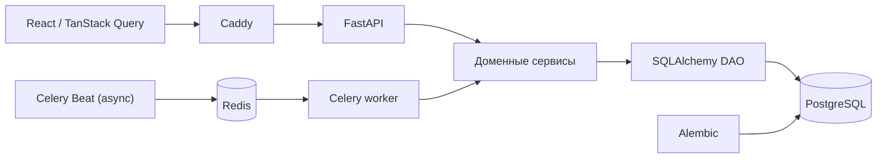

# Архитектура «Пульса»

«Пульс» — SPA на React и модульный монолит FastAPI. Caddy обслуживает собранный интерфейс и проксирует `/api/*` на внутренний API. Экраны учебного кабинета получают данные по тому же origin. Миграции выполняет одноразовый сервис Compose, после чего запускается API. PostgreSQL хранит учебные данные, историю заявок, уведомления, сессии и общие счётчики входа.

| Срез | Маршруты в `/api/v1` | Доступ |
|---|---|---|
| Вход и профиль | `POST /auth/login`, `GET /auth/me`, `GET /auth/csrf`, `POST /auth/logout`, `GET /profile` | Origin при входе, сессия для профиля, Origin и CSRF для выхода |
| Расписание | `GET /schedule` | Группа из записи студента, включая переход к занятию из уведомления |
| Учёба | `GET /study`, `GET /exams` | Зачисления текущего студента |
| Заявки | `GET /request-types`, `GET /requests`, `POST /requests`, `GET /requests/{request_id}` | Текущий владелец, создание с Origin и CSRF |
| Уведомления | `GET /notifications`, `POST /notifications/{id}/read` | Владелец, доступная связанная запись, Origin и CSRF для прочтения |
| Мой день | `GET /dashboard` | Те же фильтры, что на отдельных страницах |
| Эксплуатация | `GET /health/live`, `GET /health/ready` | Публичный минимум о состоянии |

Занятие хранит действующие начало, конец и аудиторию. Для отменённого занятия они остаются временем отменённого события. DAO присоединяет последнее изменение по времени и UUID. День и неделя определяются в `Europe/Moscow`.

Итог по дисциплине определяется последней итоговой оценкой. Для экзамена `3`, `4` и `5` означают «сдано», для зачёта — «зачёт» или «зачет». При отсутствии итога результат ожидается. Сессия по умолчанию использует учебный период `demo`. Главная приоритизирует переносы и отмены сегодня, ближайшую аттестацию в течение трёх дней и последнюю готовую заявку. Порядок детерминирован, максимум три события.

В профиле `async` один экземпляр Beat каждую минуту отправляет в Redis задачу без данных студента. Воркер выбирает получателей в PostgreSQL по зачислениям и состоянию аккаунта. UUID напоминания зависит от студента, экзамена и правила «за 24 часа». Вставка по этому ключу защищает от дублей при одновременной обработке и повторной доставке. Redis доступен в отдельной внутренней сети Beat и воркеру.

Разделение доступа и предусмотренные проверки описаны в [модели угроз](security.md). Структуру таблиц описывает [ER-диаграмма](database-erd.md), точные HTTP-ответы — [§7 технического задания](../Task.md#7-api-контракт-точные-запросы-json-ответы-и-ошибки-p0).
