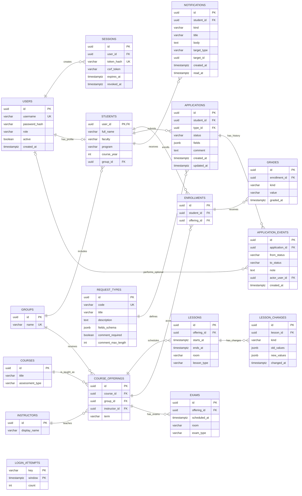

# ER-диаграмма БД — «Пульс»

Диаграмма **MVP** для PostgreSQL / SQLAlchemy 2 / Alembic. Источник функциональных требований — [`Task.md`](../Task.md), §8 и §10. Для Mermaid Live Editor можно использовать исходник [`database-erd.mmd`](./database-erd.mmd).

## Семантика и ограничения

- `STUDENTS.user_id` — одновременно **PK** и **FK** на `USERS.id`. Студентский `student_id` в `ENROLLMENTS`, `APPLICATIONS` и `NOTIFICATIONS` ссылается на `STUDENTS.user_id`. У сотрудника (`USERS.role = staff`) профиль в `STUDENTS` необязателен.
- `LOGIN_ATTEMPTS` хранит общие счётчики входа по хешу имени или адреса и началу временного окна. Составной PK обеспечивает атомарное увеличение, индекс окна используется для удаления устаревших счётчиков.
- `ENROLLMENTS.id` — отдельный UUID **PK**, чтобы `GRADES.enrollment_id` ссылался на один конкретный enrollment. Дополнительно требуется `UNIQUE(student_id, offering_id)`; этот составной уникальный индекс не отображается в колонках диаграммы.
- `SESSIONS.token_hash` хранит только хеш случайного значения из HttpOnly cookie, **не** исходный токен. `SESSIONS.revoked_at`, `NOTIFICATIONS.read_at`, `APPLICATIONS.comment`, `APPLICATION_EVENTS.actor_user_id` и `APPLICATION_EVENTS.from_status` могут быть `NULL` по смыслу домена (первое событие не имеет старого статуса; системное событие — автора).
- `APPLICATIONS.fields` хранит JSONB, **проверенный** по `REQUEST_TYPES.fields_schema`; сама DB-схема не заменяет серверную валидацию Pydantic и бизнес-правил.
- `LESSONS` хранит действующие время и аудиторию. В `LESSON_CHANGES` сохраняются прежние и новые значения. При отмене новое значение равно `NULL`, время в `LESSONS` сохраняется.
- `NOTIFICATIONS.target_type` + `target_id` — необязательная полиморфная ссылка для UI; **внешнего ключа на произвольную таблицу здесь нет**, и ни одно действие по ней не может обходить ownership check.
- Допустимые значения `USERS.role`, статусов `APPLICATIONS.status`, типов событий и оценок нужно зафиксировать через `Enum`/`CHECK` в Alembic. `STUDENTS.course_year` ограничен `1..6`; `LESSONS.ends_at > starts_at`.
- Для запросов критичны индексы на `SESSIONS.token_hash`, `STUDENTS.group_id`, `LESSONS(offering_id, starts_at)`, `ENROLLMENTS(student_id, offering_id)`, `APPLICATIONS(student_id, created_at)`, `APPLICATION_EVENTS(application_id, created_at)`, `NOTIFICATIONS(student_id, created_at)`; состав и направления индексов проверяются на реальных запросах.
- Все временные метки в БД — `TIMESTAMPTZ` (UTC), в интерфейсе демонстрационные даты отображаются в `Europe/Moscow`.

## Защита от доступа к чужим данным

- `user_id`/`student_id` текущего студента определяется **по серверной сессии**, а не из path/query/body.
- `APPLICATIONS` и `NOTIFICATIONS` всегда читаются и обновляются с SQL-фильтром `student_id = current_student_id`.
- `GRADES` доступны только через `ENROLLMENTS.student_id = current_student_id`.
- `LESSONS` доступны через `STUDENTS.group_id` → `COURSE_OFFERINGS.group_id`; `EXAMS` — через `ENROLLMENTS` (а не просто по группе).
- Изменение статуса заявки и добавление `APPLICATION_EVENTS` выполняются **одной транзакцией**; чужой или несуществующий приватный UUID даёт одинаковый HTTP `404`.

## Где реализуется схема

| Таблицы | SQLAlchemy models (`backend/app/db/models/`) | DAO (`backend/app/db/dao/`) |
|---|---|---|
| `users`, `sessions` | `user.py`, `session.py` | `user_dao.py`, `session_dao.py` |
| `login_attempts` | `user.py` | `login_dao.py` |
| `students`, `groups` | `student.py` | `student_dao.py` |
| `instructors`, `courses`, `course_offerings`, `lessons`, `lesson_changes` | `schedule.py` | `schedule_dao.py` |
| `enrollments`, `grades`, `exams` | `study.py` | `study_dao.py`, `exam_dao.py` |
| `request_types`, `applications`, `application_events` | `application.py` | `application_dao.py` |
| `notifications` | `notification.py` | `notification_dao.py` |

**Важно:** диаграмма описывает целевую схему, но сама по себе таблиц не создаёт. Источник исполняемой схемы — Alembic-миграции; при изменении сущностей обновлять эту диаграмму, модели, миграции, DAO, DTO и тесты в одной задаче.
